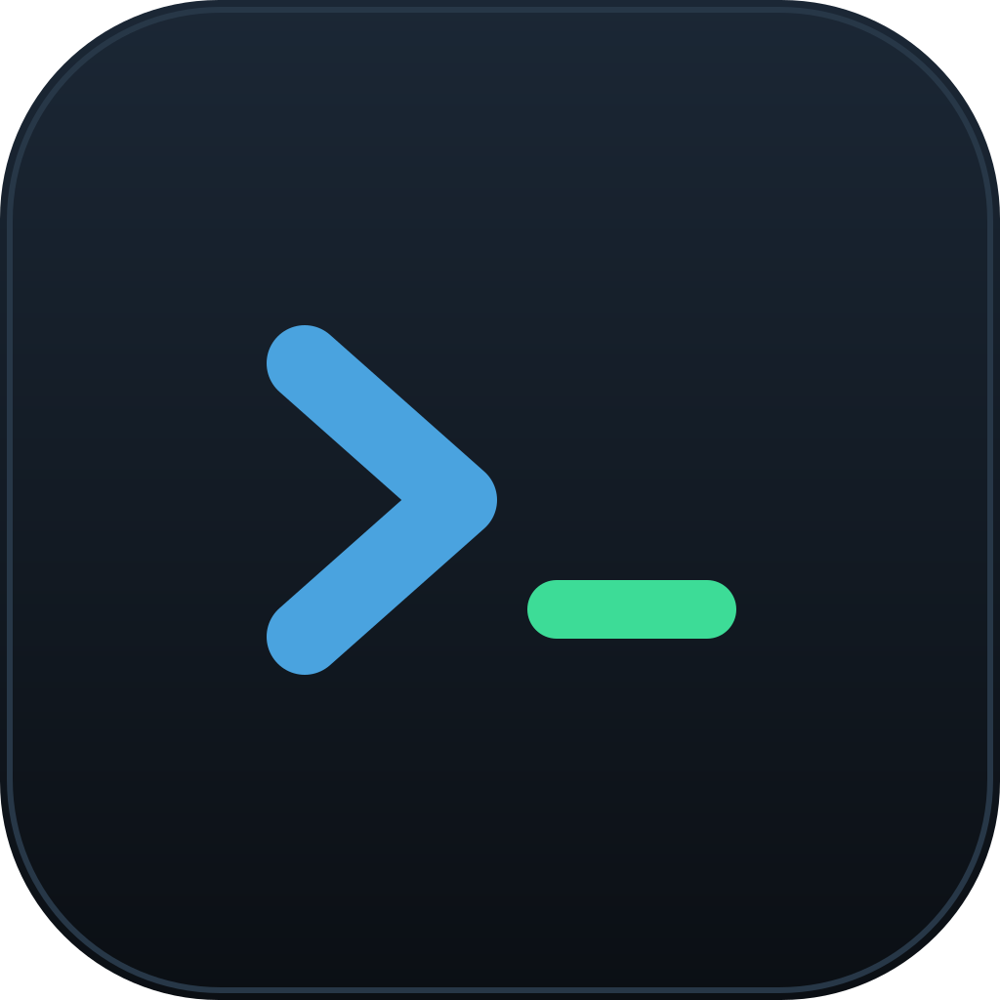

<div align="center">
  
  <h1>Drossh</h1>
  <p><b>Client SSH léger</b> — terminal, gestionnaire de connexions et explorateur de fichiers SFTP.</p>
</div>

---

Drossh est un client SSH de bureau, léger (~10 Mo) et rapide, construit avec
[Wails](https://wails.io) (Go + interface web). Il réunit dans une seule fenêtre
un terminal, tes connexions rangées en dossiers, et un explorateur de fichiers
distant — avec édition des fichiers directement dans ton éditeur habituel.

## Fonctionnalités

- 🔌 **Connexions SSH** sauvegardées, rangées en dossiers (glisser-déposer)
- 🔑 Authentification par **mot de passe** ou **clé privée** (gestionnaire de clés)
- 🪟 **Terminal** multi-onglets (xterm.js), copier/coller `Ctrl+Maj+C/V`
- 📂 **Explorateur SFTP** : navigation, icônes par type de fichier, clic droit
  (nouveau fichier/dossier, supprimer, « ouvrir un terminal ici »)
- ✨ **Édition aller-retour** : double-clic sur un fichier → il s'ouvre dans ton
  éditeur par défaut, et chaque sauvegarde est **ré-uploadée automatiquement**
- 🧭 Fil d'Ariane cliquable, panneaux redimensionnables et repliables

## Installation

- **Arch / CachyOS / Manjaro** (AUR, avec `yay` ou `paru`) :
  - `yay -S drossh-bin` — binaire précompilé, installation instantanée *(recommandé)*
  - `yay -S drossh` — compilation depuis les sources
  - *(ou `paru -S drossh-bin` / `paru -S drossh`)*
- **Ubuntu / Debian** : télécharger le `.deb` depuis les
  [Releases](../../releases)
- **AppImage** (toute distro Linux) : télécharger le `.AppImage`, le rendre
  exécutable (`chmod +x`) et le lancer
- **Windows** : télécharger le `.exe` depuis les [Releases](../../releases)

## Développement

Tout l'outillage reste dans Docker (rien à installer sur la machine hôte) :

```bash
# Construire l'image de dev (Go + Node + Wails)
docker build -t drossh-dev -f Dockerfile.dev .

# Compiler l'application
./dev.sh build -tags webkit2_41

# Le binaire se trouve dans build/bin/drossh
```

> Sous Linux, l'app a besoin des bibliothèques `webkit2gtk-4.1` et `gtk3` pour
> s'exécuter (déjà présentes sur la plupart des bureaux).

## Licence

[MIT](LICENSE) © Jules Pauly
