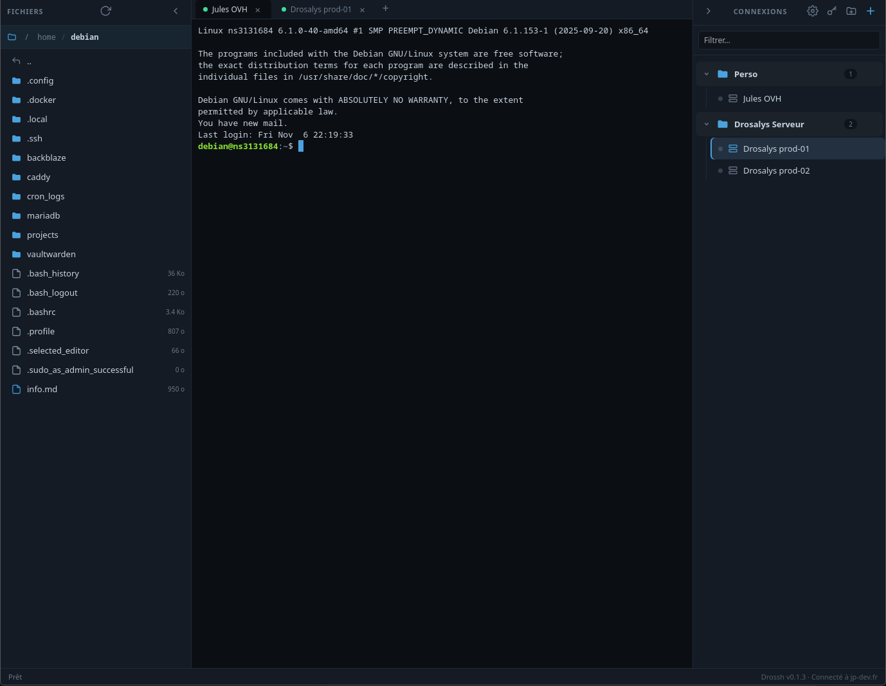
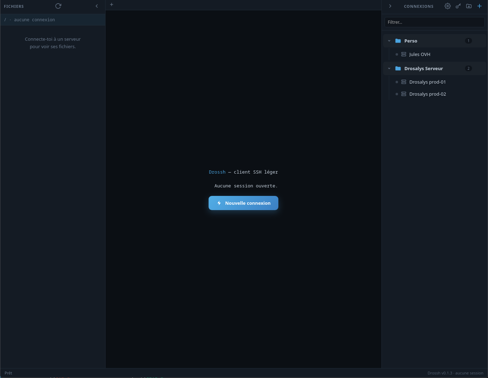
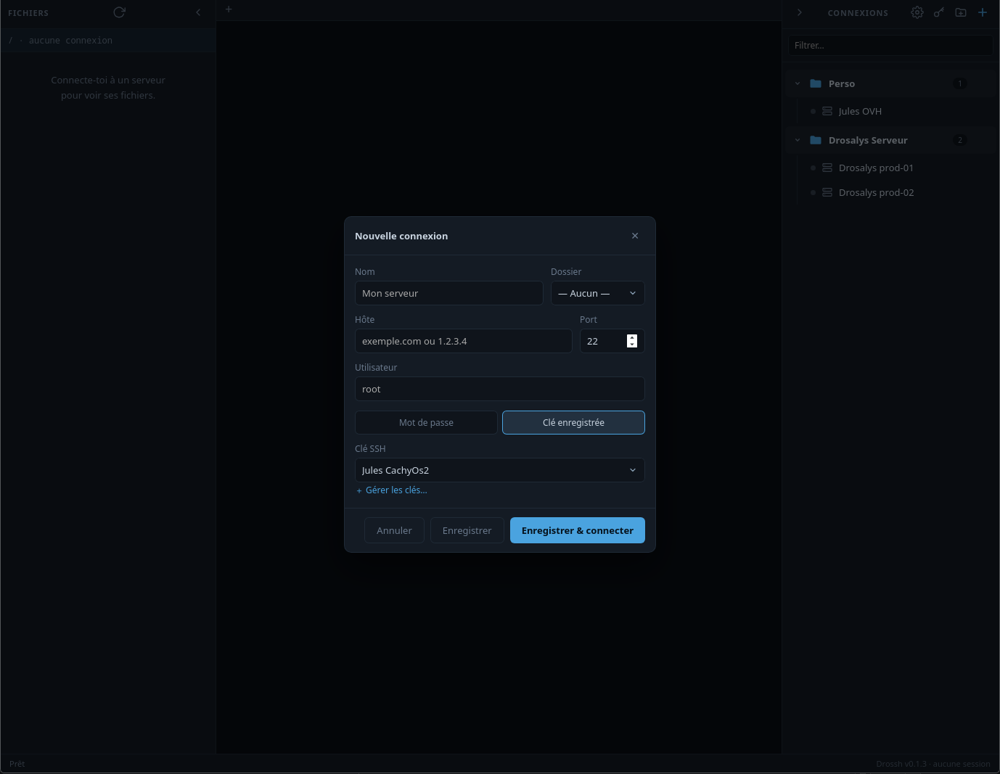

<div align="center">
  
  <h1>Drossh</h1>
  <p><b>Client SSH léger</b> — terminal, gestionnaire de connexions et explorateur de fichiers SFTP.</p>
</div>

---

Drossh est un client SSH de bureau, léger (~10 Mo) et rapide, construit avec
[Wails](https://wails.io) (Go + interface web). Il réunit dans une seule fenêtre
un terminal, tes connexions rangées en dossiers, et un explorateur de fichiers
distant — avec édition des fichiers directement dans ton éditeur habituel.

## Aperçu

<div align="center">
  
  <p><i>Une session active : terminal multi-onglets au centre, explorateur SFTP à gauche, connexions rangées en dossiers à droite.</i></p>
</div>

<table>
  <tr>
    <td width="50%">
      
      <p align="center"><i>Écran d'accueil — connexions rangées en dossiers</i></p>
    </td>
    <td width="50%">
      
      <p align="center"><i>Nouvelle connexion — mot de passe ou clé enregistrée</i></p>
    </td>
  </tr>
</table>

## Fonctionnalités

- 🔌 **Connexions SSH** sauvegardées, rangées en dossiers (glisser-déposer)
- 🔑 Authentification par **mot de passe** ou **clé privée** (gestionnaire de clés)
- 🪟 **Terminal** multi-onglets (xterm.js), copier/coller `Ctrl+Maj+C/V`
- 📂 **Explorateur SFTP** : navigation, icônes par type de fichier, clic droit
  (nouveau fichier/dossier, supprimer, « ouvrir un terminal ici »)
- ✨ **Édition aller-retour** : double-clic sur un fichier → il s'ouvre dans ton
  éditeur par défaut, et chaque sauvegarde est **ré-uploadée automatiquement**
- 🧭 Fil d'Ariane cliquable, panneaux redimensionnables et repliables

## Installation

- **Arch / CachyOS / Manjaro** : l'**AppImage** (voir ci-dessous).
  > ℹ️ La publication sur l'AUR n'est pas encore disponible — en attendant,
  > utilise l'AppImage, qui fonctionne sur toutes les distributions.
- **Ubuntu / Debian** : télécharger le `.deb` depuis les
  [Releases](../../releases)
- **Windows** : télécharger le `.exe` depuis les [Releases](../../releases)

### AppImage (toute distribution Linux)

L'AppImage est un fichier unique, sans installation ni dépendances à gérer.

1. Télécharge le fichier `Drossh-*.AppImage` depuis les [Releases](../../releases).
2. Rends-le exécutable :
   ```bash
   chmod +x Drossh-*.AppImage
   ```
3. Lance-le :
   ```bash
   ./Drossh-*.AppImage
   ```

> 💡 Pour l'avoir dans ton menu d'applications, tu peux le déplacer dans
> `~/Applications/` (ou `~/.local/bin/`) ; la plupart des bureaux l'intègrent
> alors automatiquement. Sinon, l'outil [Gear Lever](https://flathub.org/apps/it.mijorus.gearlever)
> gère l'intégration et les mises à jour des AppImage en un clic.
>
> Sous Linux, l'AppImage a besoin de `webkit2gtk-4.1` et `gtk3` sur le système
> (déjà présents sur la plupart des bureaux). Si rien ne s'affiche (fenêtre
> blanche) sur une carte NVIDIA, lance-le avec `WEBKIT_DISABLE_DMABUF_RENDERER=1 ./Drossh-*.AppImage`.

## Développement

Tout l'outillage reste dans Docker (rien à installer sur la machine hôte) :

```bash
# Construire l'image de dev (Go + Node + Wails)
docker build -t drossh-dev -f Dockerfile.dev .

# Compiler l'application
./dev.sh build -tags webkit2_41

# Le binaire se trouve dans build/bin/drossh
```

> Sous Linux, l'app a besoin des bibliothèques `webkit2gtk-4.1` et `gtk3` pour
> s'exécuter (déjà présentes sur la plupart des bureaux).

## Licence

[MIT](LICENSE) © Jules Pauly
